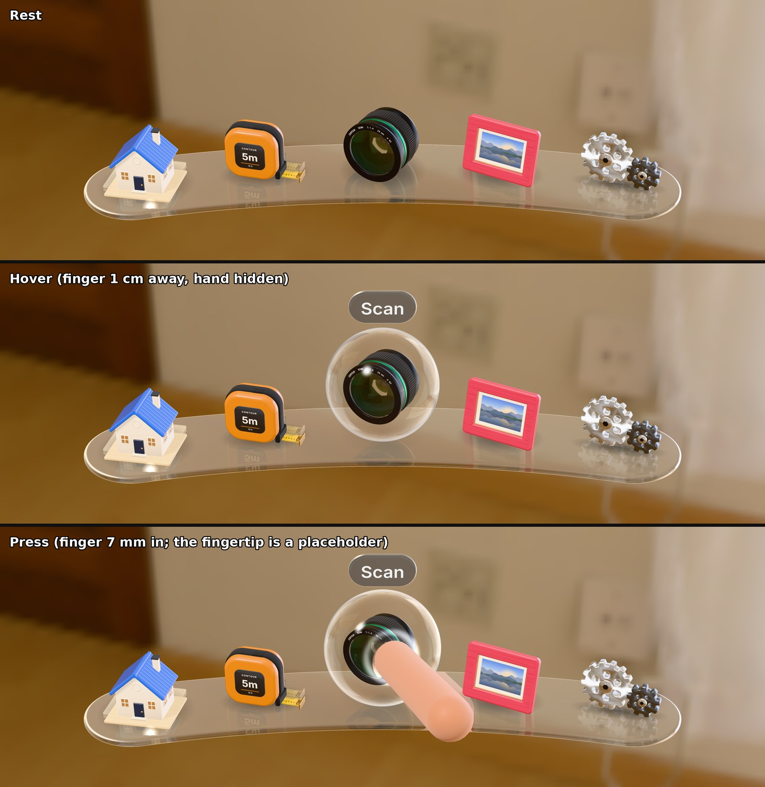

# Core components

Four three.js + WebXR components built on the tokens: **Button**, **Z-Slider**, **Packaging panel** and **Dock**. They don't hold any numbers of their own: every size, timing and ratio is read from [`tokens.json`](../tokens.json), so changing a token changes every component that uses it. The few values the tokens don't cover yet are collected in one file, listed [below](#values-the-tokens-dont-cover-yet).


*Captured 2026-10-20 from the demo, 2560 × 1600.* The Dock (curved glass shelf) and Z-Slider (amber glass stem) are the first live builds of their lookdev and are **in progress**: see [Dock](#dock) and [Z-Slider](#z-slider).

## Run the demo

```sh
npm install
npm run dev            # desktop browser: http://localhost:5173
npm run dev:headset    # https on your network, for a headset browser
```

The demo is a Room planner scene in a photographed living room: a Catalog window (packaging), a toolbar under it (buttons in all three densities), a Lamp knob (Z-Slider, which dims the room) and the Dock. On desktop the mouse acts as a far ray: hover, click to press, wheel or drag to push the Z-Slider, drag empty space (or ← →) to turn. In a headset, a hand closer than 35 cm to a component pokes it with the index fingertip, and further away it uses a ray with pinch. Edit `tokens.json` while the dev server runs and the page reloads with the new values.

Other commands: `npm test` (token check + interaction logic tests), `npm run shot` (renders the demo in headless Chromium and saves screenshots of each state to `shots/`), `npm run bench` (renders the Catalog window alone at a fixed framing in every state, to `shots/bench/`, for scored rounds against the visionOS bar), `npm run build` (static site in `site/`).

## How it looks

Behaviour comes from tokens; appearance lives in [`src/core/look.js`](../src/core/look.js). The bar is a shipping visionOS app. The Catalog window has been rebuilt to [the Catalog spec](catalog-spec.md); the toolbar, Z-Slider and Dock now use the same glass (2026-10-20).

- **Glass windows.** A window is a thick glass slab with a fully rounded rim. It shows the room behind it frosted and darkened, refracts it at the rim, reflects the room in front (strongest at the rim), and has a fine frost grain. It reads the room from the backdrop's light map along the view ray, so it works per eye in a headset with no extra render pass.
- **Adaptive scrim.** Over a bright part of the room the glass darkens just enough to keep white text legible, up to `color.scrim.opacity.maximum`.
- **Contact shadows.** Layers that float in front of a window (a child level, a lifted row) cast soft shadows on it, softer the further away they are.
- **Thick controls.** Buttons and knobs are rounded solids extruded to their token thickness. Pressing compresses the solid and the face content moves with it. Thickness says "pressable", so windows don't have it.
- **List rows** are invisible at rest. On hover a light glass lens lifts out of the window, carrying the row with it; on press it moves back and shrinks slightly. Icons sit in glass beads.
- **Type ramp.** Inter as signed-distance-field text, on Apple's visionOS ramp converted at 1 pt ≈ 0.73 dmm (`DEFAULTS.type`). Secondary text is white at 72 %, not grey, so it stays legible over glass (vibrancy).
- **Backdrop.** On desktop and in VR the scene is a photographed interior (Poly Haven "lebombo", CC0), also used as the light. In mixed reality your real room replaces it.

Appearance options on `Button`: `shape` (`rounded`, `capsule`, `circle`), `variant` (`secondary`, `primary`, `plain`, `glass`, `tinted`, `window`), `icon`, `label`, `sublabel`, `accessory: 'chevron'`, `layout: 'row'`. `makePlatter()` draws a non-interactive toolbar background.

**Glass in mixed reality.** WebXR never gives the page the camera image of your room, so in mixed reality the glass cannot blur it. There the sheet falls back to a tinted surface at `material.opacity.default`, which keeps text readable over any room. On desktop, in VR and in the arena, it is real frosted glass.

## Using a component

```js
import tokenJson from './tokens.json';
import { createTokens, Button, InputSystem } from './src/index.js';

const T = createTokens(tokenJson);            // tokens in metres, seconds, radians
const ok = new Button(T, { label: 'OK', density: 'firm' });
ok.addEventListener('select', () => console.log('pressed'));
scene.add(ok);

const input = new InputSystem({ T, renderer, camera, scene });
renderer.setAnimationLoop(t => {
  input.update();      // turns mouse / hands / controllers into probes
  ok.update(dt);       // each component reads its probes
  renderer.render(scene, camera);
});
```

`createTokens(json)` resolves aliases and shares unit conversion with the build pipeline: m stays m; vpt becomes m at 1 m; deg becomes rad; ms becomes s. `T.viewSize(name, distance)` applies the placement-time f(d) rule, and `T.touchSize(name, distance)` also applies the 22 mm fingertip floor. Physical hover and direct-input distances use `T.get()` without distance scaling. Runtime JSON input is retained so Arena overrides reach the real components. Generated `dist/tokens.js` exports nested values and numeric sizing helpers; it is not a drop-in replacement for the runtime API.

Width, height, radius and layout defaults still accept their existing dmm numbers, scaled by the same f(d). `o.density` remains the component option while tokens use `firmness`. Legacy `T.dmm()` and exported `atDistance()` retain linear behavior for old dmm inputs. Direct-touch hit areas expand to the fingertip floor without changing visible faces or ray hit areas. Closely packed targets in the hand zone still need headset overlap/usability checks.

## Button

A thick object that compresses toward its back face when poked.

| Behaviour | Tokens |
|---|---|
| Thickness | `material.thickness.thin / regular / thick` |
| Press depth = ratio × t; recover time | `material.firmness.{soft,firm,rigid}.pressDepth`, `motion.recovery.{soft,firm,rigid}.duration` |
| Press starts on contact; release after the finger retreats 3 mm from the deepest point | `input.poke.pressTrigger`, `input.poke.distance.release` |
| Hover on at 100 mm, off at 140 mm | `input.hover.distance.enter`, `.exit` |
| Hover glow fades in, 2 vpt wide | `motion.enter.*`, `material.glow.width` |
| Face size 80 vpt (60 mm at 1 m) | `size.interactive.default` |
| Opaque surface with a high-contrast outline | `material.opacity.default`, `material.outline.width` |

Disabled buttons are always `rigid`: they barely give, which reads as "not now". Events: `press`, `release`, `select`, `cancel` (finger slid off).

## Z-Slider

A knob you push away from you (value up) and pull back (value down), along Z instead of X.

| Behaviour | Tokens |
|---|---|
| Travel from fully pulled to fully pushed | `zslider.travel` |
| A tick every 1/10 of the range, as sound | `feedback.detent.interval`, `.audio.gain`, `.audio.length` |
| Contact shadow grows and darkens with push | `shadow.contact.*` |
| Hover, glow, surface | as Button |


*Rendered 2026-10-20 in Blender.* **In progress:** Jihoon picked this direction (A, stem) on 2026-10-20. The live knob (see the overview) is built to it: a clear amber glass bead on a translucent amber stem (the room shows through it; a crisp highlight runs along its top) that flows into the plate and into the knob through curved fillets (stem and fillets are one piece of glass). The fillets follow a superellipse profile: a short flare into the plate and a long bell into the knob, so the curve shows beside the knob instead of hiding behind it. Under it sit a thin clear glass plate (`material.thickness.thin`; the room shows through it in its own colour and its rim catches the light, as in the lookdev), five etched rings that light amber up to the value (unlit rings stay visible as frosted etches), a glow that rises with the value (inside the glass, round the lit rings, a halo in the knob's own plane, and a warm pool on the plate round the stem's foot), and the value label on a thin capsule of neutral grey smoked glass beside the plate (Jihoon chose this on 2026-10-21; half the plate's thickness, and only as long as its text needs, with room for any two-digit value, so it holds still while you drag (only 100% widens it) and the words never meet). The value is larger and bolder than the name; both are full white, because secondary-opacity text fell to 4.1:1 on the glass. Values: `DEFAULTS.look.lampGlow` (`fillet.plate`, `fillet.knob`, `spill`), `DEFAULTS.look.valueLabel`, `DEFAULTS.look.refract.plate`, `.label`.

How each input moves it: a fingertip can only **push** the face (like a real knob). **Pinching** near the knob grabs it so it can be pulled back. A **ray** (mouse, controller) drags it: moving the pointer further away pushes. The value is shown beside the knob, not on it, so the hand doesn't cover it. Five rings on the plate show the value at a glance (each is two detents); the 10 detents are felt as ticks. Events: `change`, `detent`.

## Packaging panel

A list whose rows open into a child panel that grows out of the row, instead of sliding in from the side.


*Captured 2026-10-20 from the demo, 2560 × 1600.*

| Behaviour | Tokens |
|---|---|
| What the parent does: compress, replace or protrude | `packaging.parent.mode` (switchable with `setMode()`) |
| Compress: back 50 mm, up 35 mm, 8 % smaller per level | `packaging.parent.recede.z / y / scale` |
| Parents darken 0.6 → −0.14 per level, never below 0.3 (they don't turn see-through) | `packaging.parent.recede.opacity.*` |
| Up to 3 levels deep; deeper rows show as disabled | `packaging.depth.max` |
| Open and close: a critically damped spring, response = the dropdown duration | `motion.expand.duration` |

Rows use the bubble language (see Decisions): on hover the window glass swells into a pillow under the row; on press a dent gives way where the press lands and lights from inside.


*Captured 2026-10-20 from the demo, 2560 × 1600.*


*Captured 2026-10-20 from the demo, 2560 × 1600.* Receded parents are pressable: pressing one goes back to it. That is the wayfinding idea from the concepts doc: their headers are the breadcrumb. Try "replace" in the demo and the breadcrumb disappears. The child grows out of the row that opened it and closes back into it, and a fast open-and-back never jumps, because every channel is a spring that starts from where it is. Navigation is never locked while levels move: going back and at once opening another row works, and a level on its way out takes no input. With reduced motion, levels fade in and out where they belong instead of travelling and growing (option `reducedMotion`, default: the viewer's setting). Glass never shows another glass sheet through it, so a child always covers its parent cleanly. The panel itself is a `rigid`, `thin` glass sheet; rows are `thin`, `firm` buttons. Events: `open`, `back`, `select`.

## Toolbar

An ornament of actions under a window: one glass bar whose buttons are places where its own glass swells into a bubble on hover and dents on press. The primary action is a patch of accent-tinted glass (`DEFAULTS.color.accentGlass`), so the room shows through it blue; in tinted glass the press light takes the glass's colour. Events: `select` (with the tool and its index).


*Captured 2026-10-20 from the demo, 2560 × 1600.*

## Dock

The app launcher, body-locked 25° below your view. Each app is a small object drawn the way Mac OS X icons are, standing on a curved plate of solid glass bubble. A finger near one forms a clear bubble round it, and the bubble can be pressed like the list bubble (Jihoon, 2026-10-21, from his reference image of a classic Mac dock with a subtle bubble). Pinch an end of the plate and pull to make every app bigger; the plate's length otherwise follows the apps, so adding one lengthens it by itself.


*Live render, 2026-10-21, from `demo/bench.html?part=dock` (stretch and press: a fingertip stand-in, `&hand`, a placeholder, not a hand model).* **In progress:** there is no path-traced reference for this design yet, so it has not been matched to one.

- **Objects.** Each app is an object built in code ([`src/core/objects.js`](../src/core/objects.js)): Planner a house, Measure a tape measure, Scan a camera lens, Photos a picture frame, Settings a gear, Notes a cube of sticky notes, Clock a twin-bell alarm clock. They follow Apple's Mac OS X icon rules (HIG 2008, "Icon Design"): seen straight on, lit from directly above and slightly in front, one simple idealised form each with no props or bases, glossy clean materials, and one visual weight across the family (optical sizes, not equal boxes: a round lens is drawn larger than a square frame). Lit by the room (dimmed to 45%) plus five soft boxes, mostly from above, and a key light above and in front that casts shadows (`DEFAULTS.look.dockObjects`). They are **placeholders** for objects an app would ship itself.
- **Icon styles (exploration, 2026-10-21).** The same objects can be drawn four ways, for Jihoon to pick one as the reference ("Please explore 3d icons. Then I'll choose one for the reference."). An app's `style` (the bench's `?icons=`) picks one of `ICON_STYLES`: `object` (the Mac OS X icon objects above, the default); `clay` (like Microsoft's Fluent 3D emoji: one soft matte material, colours lifted toward white, a velvety sheen); `glass` (like Liquid Glass's tinted and clear icons: every part is clear glass tinted its colour, with a rim that glows where it turns away; printing such as a label or a photo stays solid); `disc` (like a visionOS app icon: the object in white relief on a round disc of the app's colour, under a clear glass layer); `jelly` (after BUCK's Cash App "Evergreen" 3D system, [buck.co](https://buck.co/work/cash-app-visual-identity); Jihoon: "copy the style of cash app": one hero colour for every app, its coloured parts a frosted see-through jelly lit from inside with fine flecks in it, the rest white satin, satin silver and black; an object with no coloured part takes the hero on its dark parts). ⚠️ The jelly's hero is Cash App's own green (`JELLY.hero`), a stand-in until Contour picks its own accent. Once one style is chosen the others go.
- **Plate.** A solid bubble: Contour's glass swollen into a cushion, round at every edge and domed under the apps, refractive, bent on an arc centred on you. Each object has a faint mirror image in it, fading with depth, and a soft contact shadow. Its ends, past the last app, are handles (see Stretch).
- **Stretch.** Pinch an end (or point at it and press) and pull. The plate grows from its middle, the end in your hand following it exactly, and every app (and the gaps between them) grows with it, up to 1.5× (Jihoon: "App size first. Because dock length gets automatically longer when you add apps to the dock"), as dragging the macOS Dock's divider sets its icon size. Push in and they shrink back, down to their resting size. Past the largest or smallest size the plate resists (rubber-banding) and thins or fattens like a held bubble, while the apps hold at the limit. Let go and it settles where the pull was heading (Apple's momentum projection) with your hand's speed, at that size: there are no steps. A hand near an end swells it a little and lights it in the press glow's colour; holding it lights it more.
- **Adding an app.** The plate's length follows the apps in it. Add one (`dock.showApps(k)`, a stand-in until apps can be pinned at run time) and the plate lengthens by itself while the new app forms at the right end, fading in from 0.9× its size. The fit is critically damped: no hand threw it, so it doesn't overshoot.
- **Hover.** A clear bubble 1.42× the object's size forms round it, resting on the shelf, and the object rises to its middle as if picked up; the app's name appears above. The bubble grows from 0.9× its size with a small settle (the list bubble's spring) and goes without one. It is a thin clear skin: it reflects the room faintly face-on and strongly at its rim (Fresnel), with one small key highlight. Its reflections keep only 30% of the room's colour and take the rest as cool white light (`dockBubble.reflectColour`), so a warm room doesn't tint it amber and it stays light, as in the reference. Only the app nearest the finger shows a bubble, so a finger between two never lights both.
- **Press.** The skin gives way where the finger pushes: the list bubble's dent (`look.emboss.dent`, 1.6× deeper, because the bubble is small and round), with a thin bright lip round the fingertip and the wall turned from the light in shade. The bubble squashes a little against the shelf, the object moves back from the finger and shrinks a touch, and the press glow lights the object from inside the dent. On release the dent springs back past flat once and `select` fires. A ray press (pinch) pushes the dent all the way in.

| Behaviour | Tokens |
|---|---|
| Body-lock (only mode implemented) | `anchor.mode` |
| 25° below the centre of view | `anchor.eccentricity.vertical` |
| Waits 350 ms after a turn, then follows without wobble | `anchor.follow.delay`, `.damping`, `.frequency` |
| Apps grow up to 1.2× within 100 dmm of the hand, cosine falloff. They grow in place: neighbours and the shelf don't move. The size eases toward the hand's value with a critically damped spring that settles in the hover duration, so tracking jitter doesn't shake the apps and a lost hand doesn't pop them | `dock.magnify.*`, `motion.enter.duration` |
| The bubble forms within hover distance of its skin, and goes past the exit distance | `input.hover.distance.enter`, `.exit` |
| The dent follows the finger in and recovers at the soft material's pace; release has hysteresis | `motion.recovery.soft.duration`, `input.poke.distance.release` |
| Object size; the gap between apps leaves room for a fully magnified bubble to clear its neighbours' objects (their real width, not their size box, so apps stand close as in the reference) | `size.interactive.default`, `DEFAULTS.look.dockShelf.bubbleClear` |
| The plate's ends are handles at least a target long; a hand there takes it from the apps (no bubble, no magnify) | `size.interactive.minimum`, `DEFAULTS.look.dockPlate.pad` |
| An end lights and swells within hover distance; a pinch within 40% of it grabs | `input.hover.distance.enter`, `.exit`, `dockPlate.reach` |
| Release settles with a spring of response 0.35 s and damping 0.8 (Apple's drawer after a drag), carrying the hand's speed; reduced motion: damping 1, no overshoot | `DEFAULTS.look.dockPlate.settle` |
| An added app: the plate fits it with a spring of response 0.4 s and damping 1 (Apple's reposition) | `DEFAULTS.look.dockPlate.fit` |

WebXR doesn't track the torso, so the dock treats a sustained head turn (more than 20°, held for the delay) as a body turn. A quick glance away never moves it. Events: `select`.

## Lookdev frames kept for comparison

Path-traced Blender references and 6K stills, in [`images/lookdev/`](images/lookdev/):

| File | What it shows | Captured |
|---|---|---|
| `bubble-blender-states.jpg` | The bubble reference in Blender: rest, hover, press | 2026-10-19 |
| `catalog-press-6k.jpg` | Live Catalog at 6K (6144 × 3456), row pressed | 2026-10-20 |
| `row-hover-vs-press-6k.jpg` | 100 % crop of a 6K row: hover next to press | 2026-10-20 |
| `press-0.6m-vs-2m-6k.jpg` | The same press at 0.6 m and 2 m (emboss scales with distance) | 2026-10-20 |
| `dock-options.jpg` | Dock directions A bead, B inlay, C layered (before the shelf) | 2026-10-20 |
| `slider-options.jpg` | Z-Slider directions A stem, B column, C membrane | 2026-10-20 |
| `slider-stem.jpg` | Z-Slider A refined (in progress) | 2026-10-20 |

## Input

`InputSystem` turns every input into the same kind of "probe" in each component's own space, so components don't care where input came from:

| Input | Becomes |
|---|---|
| Hand or controller within 350 mm (±50 mm hysteresis) of a component | **poke**: the index fingertip (or controller grip) position, plus pinch state |
| Hand or controller further away | **ray** from the hand or controller, pinch/trigger = press |
| Desktop mouse | **ray** from the camera, click = press, wheel = push/pull |

## States and input

What every interactive component (Button and the rows and toolbar built from it, Dock apps, Z-Slider, Packaging windows) does, and what it doesn't.

| State | What you see | What it does |
|---|---|---|
| Default | The resting material | Takes hover and press |
| Hover | Bubble: the glass swells (rows, toolbar) or forms round the object (Dock); lens style: a lens lifts | Nothing fires; a fingertip enters at `input.hover.distance.enter` and leaves at `.exit`, a ray hovers while it hits |
| Press | A dent where the press lands, lit from inside; a ray press goes to full depth at once | `press`; `release` then `select` when let go on the control; `cancel` (no select) if the press slides off or its source disappears |
| Disabled (`disabled: true`, public) | Content at 40 %, no hover; the control is `rigid`, so it barely gives | Presses fire `press` and `release` but never `select` |
| Not taking input (`enabled = false`, internal) | No change of its own; the container shows why (a receded level's rows, a level on its way out) | Ignores every probe. Containers set it; apps should use `disabled` |

**Press ownership** (Button and everything built from it, Dock apps). A press belongs to the hand or ray that started it until it ends. Another hand or ray hovering the same control can't take it over or end it early. If the pressing source disappears (tracking lost), the press is cancelled and nothing is selected. A ray presses only if its pinch began on the control: a pinch dragged onto a control doesn't press it. In the Dock, an app being pressed keeps the one bubble until its press ends. The Z-Slider has no select: a pinch grab stays with the hand that grabbed it, but two rays dragging the knob at once aren't arbitrated yet (see Known limits).

**Where press feedback sits.** A fingertip drags the dent along as it moves. A ray (controller, mouse, gaze and pinch) pins the dent where the pinch began, because eye tracking wobbles about 1° (35 mm at 2 m).

**Reduced motion** (`prefers-reduced-motion: reduce`, read every frame):
- Packaging: levels don't travel or grow; they fade in and out where they belong, so depth still reads.
- Bubbles and dents (rows, toolbar, Dock apps): no settle and no rebound (damping 1).
- Dock plate: a released stretch settles without overshoot.
- Z-Slider: unchanged; its knob follows the hand directly, with no animation of its own.

**Inputs supported:** poke (fingertip or controller grip near a component), ray (hand or controller further away, desktop mouse) and pinch, as in the table above.

**Not supported yet:** keyboard focus and activation, screen readers and other assistive technology (WebXR exposes no accessibility tree for 3D content), gaze dwell without a pinch, and loading or error states (no component needs one yet).

## Values the tokens don't cover yet

These live in [`src/core/defaults.js`](../src/core/defaults.js), one file, so they're easy to find and promote. Each is a candidate token.

| Value | Now | Why it's needed | Proposed token |
|---|---|---|---|
| Placement distance for dmm | 0.6 m | dmm needs a distance to become metres | `placement.distance.near` |
| Corner radius | window 34, row 15, control 12 dmm | every surface has corners | `shape.radius.*` |
| Hover fade out | same as in | only `motion.enter` exists | `motion.hover.out.*` |
| Panel layout | width 240, row 48, padding 18 dmm, and the gaps in [the spec](catalog-spec.md) | the packaging panel's layout | `size.panel.*`, `size.row.*` |
| Type ramp | title 21 / headline 12.4 / body 12.4 / subheadline 11 / footnote 9.5 dmm (Apple's kit × 0.73) | text needs sizes, weights and tracking | `type.*` |
| Text emphasis | white at 100 / 90 / 50 % | contrast on glass | `color.text.*` |
| Dock follow threshold | 20° | without it, every small head move restarts the delay | `anchor.follow.threshold` |
| Dock distance | 0.55 m | body-lock needs a distance | `anchor.distance` |
| Glass (blur, refraction, Fresnel, grain, veil), bubble (`look.emboss`: height, dent, glow), contact shadows | see `look` | appearance of windows and rows | `look.*`, `feedback.press.*` |
| Dock plate: shape (edge 5, crown 3, under 3 mm at 0.6 m), handle 44 dmm, app size 1× to 1.5×, fit spring, rubber band 0.55, release spring, projection 0.99/ms | `look.dockPlate` | the stretchable plate | `dock.plate.*`, `dock.size.minimum`, `dock.size.maximum`, `motion.release.*` |
| Colours | dark graphite surfaces, blue accent | there are no colour tokens yet | `color.*` (MR contrast work) |

## Known limits

- **The adaptive scrim works only where the page can see the room** (desktop, VR, arena). In mixed reality it would need the camera image, which WebXR doesn't give by default; there the glass uses the fixed `material.opacity.default`.
- **Glass blurs the backdrop, not other 3D objects.** An object between the window and the room (a placed sofa) won't show through the glass. Fine for windows over a room; a real blur pass would be needed for objects.
- **The backdrop photo is 1k**, so the room looks softly out of focus. Higher-resolution interiors weren't reachable from the build environment.
- **Not yet tried on a headset.** Desktop rendering and the interaction logic are tested; hand poke and pinch follow the WebXR Hand Input spec but need a real device check, especially the follow and hover values tagged G.
- **Audio** starts after the first click or tap, because browsers block sound until the user interacts.
- **The Dock still follows the head under reduced motion.** It follows after `anchor.follow.delay` with a critically damped spring; reduced motion doesn't change that yet.
- **No keyboard or assistive technology support** (see States and input).
- **Z-Slider: two rays dragging at once.** A second ray captured on the knob while another drags it moves the knob with the first one's grab offset. Button and Dock press ownership doesn't cover it yet.

## Decisions

### Colour lives in the glass (2026-10-20)
- **Decision:** Accent colour is tinted glass: the glass's own transmission is coloured, so the room shows through it in that colour (the toolbar's primary button, Dock icons). No opaque colour fills on glass.
- **Why:** One material everywhere, and tint darkens what's behind white text, so legibility holds (Place: 11:1).
- **Alternatives:** A coloured light inside clear glass (reads as a state, not an identity); an opaque fill (clearest, but breaks the material).
- **Trade-offs:** Tinted glass changes with the room behind it; over a saturated room the hue shifts. Unsaturated colours (Settings' grey) use the plain window glass.

### Known gaps handed to the arena (2026-10-20)
- **Dock (2026-10-21):** the objects are procedural placeholders, not app assets. An added app fades in as a see-through object (its insides hidden by a depth pass); the first fade of each object compiles a shader once, which may hitch on a headset. `showApps` stands in for pinning an app; there is no add or remove gesture yet. The bubble is a thin skin with no refraction (a real soap film barely bends light), so a press reads by its lip, shade, squash and glow, and by the object giving way, not by distortion. Seen straight on, without a finger in view, the dent itself is faint; in a headset the fingertip sits in it. The objects' room light is the same photo for every app, so every app catches the same window.
- **Z-Slider:** built live as direction A (stem). The plate is `thin` glass, not the lookdev's `regular`, so its rim reads crisp. The knob's long bell fillet changes the stem's outline at every value, not only near the knob.
- **Backdrop:** the room photo is 1K; renders at 6K show it soft. A 4K+ file is needed (Poly Haven is blocked from the cloud).

### Bubble: the hover and press language (locked 2026-10-20)
- **Decision:** A hovered row doesn't get a separate lens or a colour fill. The window's own glass swells into a soft pillow under it (6 mm at 0.6 m, domed like the icon beads, glossy and clearer on the crown). Pressing makes a dent where the press lands (bell-shaped, 20 mm wide at half depth, 4.5 mm deep), shaded as a hollow with an inner shadow on the wall facing the light. Light gathers in an 8 mm core at the bottom of the dent and travels to the bubble's edge, brightest nearest the finger. On release the dent springs back past flat once; the bubble deflates without a wobble. Values: `DEFAULTS.look.emboss`.
- **Why:** Jihoon's reference is a fluid-filled tactile display: the surface itself becomes the button. Path-traced lookdev (`lookdev/catalog.py`) chose the pillow over a flat plateau, and a blind critique chose the shading and glow fixes. The glow makes the press visible by light as well as by shape (WCAG 1.4.11, non-text contrast); the bloom under text stays under the legibility cap.
- **Distance and input:** sizes are mm as seen at 0.6 m and grow with f(d), matching the window's placement-time sizing. A fingertip drags the dent along; a ray or gaze-and-pinch pins it where the pinch began (eye tracking wobbles about 1°). Far away the dent reads by shading and glow, since stereo depth fades with the square of distance.
- **Alternatives:** A light glass lens lifted over the row (`hoverStyle: 'lens'`, still available). It reads fast, but as a separate slab, not the window's own material. A squash press (whole pillow flattens): calmer, but hard to tell from hover.
- **Trade-offs:** The bubble is a shader effect on a finely split window mesh, so windows cost more vertices. Pressing directly on text briefly lowers that text's contrast under the glow core. With reduced motion, the bubble and dent move without settle or rebound.


### Dock: real objects in a pressable bubble (2026-10-21)
- **Decision:** Apps are real objects on the glass shelf, not glass globes. Hover forms a clear bubble round the nearest one (1.42× its size, resting on the shelf, the object lifted to its middle); press dents the bubble like the list bubble, squashes it a little, lights the object from the dent and moves the object back from the finger. Values: `DEFAULTS.look.dockBubble`, `DEFAULTS.look.dockObjects`.
- **Why:** Jihoon's reference (2026-10-21): photoreal objects on a curved glass shelf, the hovered one inside a faint clear sphere about 1.5× its width with a bright rim. One bubble language for Contour: the list's swell and dent, here as a sphere. On a clear sphere seen face-on a dent alone barely shows, so the press also reads by light (glow, lip) and by the object giving way, as a visionOS press recedes.
- **Alternatives:** Glass globes with glyphs inside (the 2026-10-20 build; read as candy, and not real objects). Reflections in the room's full colour (physically exact, but in a warm room the bubble read amber and heavy). A press that only squashes the whole bubble (clear, but not the list's dent). Refraction through the bubble (a thick glass ball would distort the object at rest, which the reference doesn't).
- **Trade-offs:** Apps stand further apart than in the reference (a pitch of about 1.5× an object's width, against its 1.25×), because a magnified bubble needs room to clear its neighbours. Each object is real geometry with shadows, so the Dock costs more to draw than flat icons. ⚠️ An app now has to supply an object, not an icon: that is a contract for app makers, harder to undo once apps ship assets.

### Dock objects drawn as Mac OS X icons (2026-10-21, round 3)
- **Decision:** The app objects follow Apple's Mac OS X icon rules (HIG 2008, "Icon Design"): seen straight on, lit from directly above and slightly in front, one simple idealised form, glossy clean materials, one visual weight across the family. The house is a gable straight on with no base board; the lens shows its painted, coated glass face; Settings is one gear (brushed face, dark ring, polished hub), since a second gear meshing above the plate read as floating; Notes and Clock join (added with `showApps`). Two checks hold it: D33 (in plain grey, faces turned up are the bright ones) and D34 and D43 (largest to smallest object on screen, at rest and with all seven apps: area at most 1.6×, height 1.3×; Notes is drawn smaller because a filled square reads heavier than a gear or a lens).
- **Why:** Jihoon: "Your icon design looks 3d assets in marketplace rather than icons in Mac OS." The marketplace look came from realistic detail and a casual three-quarter turn; icons idealise and face you.
- **Alternatives:** Photoreal assets with more detail (the round 1 look Jihoon turned down). Flat 2D icons on the shelf (gives up the 3D, realistic direction, 2026-10-19).
- **Trade-offs:** Idealised glass (the lens) is painted, not optically real. Equal visual weight means the objects are not to scale with each other.

### Dock plate: a solid bubble you stretch (2026-10-21)
- **Decision:** The plate is a solid glass bubble whose ends are handles. Stretching it sets the apps' size, from their resting size up to 1.5×; it never adds or hides apps. The plate's length otherwise follows the apps in it: adding one lengthens it by itself. The held end follows the hand one to one; past the limits it rubber-bands and thins or fattens; on release it settles where the pull was heading, at that size. Values: `DEFAULTS.look.dockPlate`.
- **Why:** Jihoon: "Dock plate is also solid bubble, so you can grab and stretch its length", then "App size first. Because dock length gets automatically longer when you add apps to the dock". The app count already sets the length, so the hand only needs to set one thing: size. This is the macOS Dock's model, where the Dock grows with its apps and dragging its divider sets the icon size. The feel is Apple's (apple-design): direct manipulation, rubber-banding, momentum projection, velocity handoff to a spring.
- **Alternatives:** Stretch brings out hidden apps, then grows them (built first; it made the length mean two things, and an app count is better set by adding apps). Spread the same apps out (the plate changes, the apps don't). Allow sizes below the resting one, as the macOS Dock does (more compact, but in the hand zone it shrinks press targets that are sized to be comfortable).
- **Trade-offs:** The plate gets longer ends (44 dmm handles, the smallest target size) than a plain shelf would. ⚠️ App size is now a user setting: the system has to remember it per person, and changing what the stretch means later would change people's Docks.

### Components take tokens as an argument instead of importing them
- **Decision:** `new Button(T, …)` receives a token object; no component imports `tokens.json` itself.
- **Why:** It keeps one source of truth while letting the source change. Today `T` comes from raw `tokens.json`; tomorrow from the pipeline's generated file, a Figma export, or a test fixture with different values. In Figma terms: components are linked to a library, and you can swap which library.
- **Alternatives:** Each component imports `tokens.json` directly. Shorter to use, but every component would need editing when the pipeline lands, and tests couldn't try other values.
- **Trade-offs:** One extra argument on every constructor.

### Interaction logic is separate from rendering
- **Decision:** Press, hysteresis, follow, magnify and packaging poses are small pure functions or classes (`PressModel`, `Hysteresis`, `LazyFollow`, `packagingPose`, `magnifyScale`) that the three.js components call.
- **Why:** These are the parts the tokens describe, and the parts that need to match across the website, Unity and any future renderer. Keeping them pure means they run in Node tests without a browser or headset, and can be ported one function at a time.
- **Alternatives:** Logic inside each component's update loop. Fewer files, but untestable without rendering.
- **Trade-offs:** A few more files to read when following one behaviour end to end.

### Press: down follows the finger, up springs back at the material's pace
- **Decision:** Going down, the surface tracks the finger exactly (`motion.press.behavior = follow-input`). Coming back up, it eases back so a full recovery takes exactly `density.recover`, even while the finger is still touching.
- **Why:** Recovery only shows if the surface can lag behind the finger. If it followed the finger both ways, soft and rigid would look the same on the way up, and the recover tokens would do nothing.
- **Alternatives:** Follow the finger both ways and only animate after release. Simpler, but the release hysteresis means the finger is already 3 mm back by then, so there is almost nothing left to animate.
- **Trade-offs:** A soft surface briefly separates from a fast-retreating finger. That is the intended feel, but it should be checked on a headset.

### Ray input presses fully and releases cleanly
- **Decision:** A ray (mouse, controller, far pinch) has no depth, so a ray press goes straight to full press depth, and letting go releases immediately.
- **Why:** Release hysteresis is for a finger hovering at the surface. A ray press is already a clean on/off signal.
- **Alternatives:** Simulate a finger moving in. Would make every click feel slow.
- **Trade-offs:** On desktop you see the press depth but not the "follow" feel. That only exists with hands.

### A press stays with the source that started it (2026-10-21, PR #3 review)
- **Decision:** Buttons and Dock apps remember which hand or ray (its probe id) started a press and read only that source until release or cancel (`pickProbe`). A missing source cancels. With no press, the nearest source wins, and among rays that all hit, the one whose pinch began on the control. A ray presses only when its pinch began on the control (`captured`).
- **Why:** Every ray hit counts as distance 0, so with two rays on one control the first in the list won each frame. The review reproduced a hovering ray ending another ray's press with a false `select`. Apple's rule for direct input: feedback and outcome belong to the touch that caused them.
- **Alternatives:** Pick by order or by distance only (the bug). Let the most recent source take over (a second hand passing by would steal the press). Track several presses per control at once (no control needs two simultaneous presses).
- **Trade-offs:** If a pressing hand's tracking drops for a frame, the press cancels instead of waiting for it to come back.

### Packaging keeps its navigation stack apart from closing levels (2026-10-21, PR #3 review)
- **Decision:** `PackagingStack` holds the open levels (root first, front last) and, separately, the levels on their way out. A level's depth is its index in the open stack; closing levels still draw, take no input, and are removed once faded.
- **Why:** Mixing both in one list made a level's position in the list differ from its depth: going back and opening another row before the first finished closing crashed the panel. Locking navigation until animations end would have fixed the crash but broken interruptibility (apple-design: never lock out input during a transition).
- **Alternatives:** Map indices with filters wherever they're used (the bug's shape, easy to get wrong again). Lock input while levels move (rejected above).
- **Trade-offs:** Two lists to look through when lighting levels (a closing child still shadows its parent).

### Reduced motion in Packaging: fade in place (2026-10-21, PR #3 review)
- **Decision:** With reduced motion, levels don't travel or scale. Each is where it belongs at once; opacity, darkening and the hidden list still animate.
- **Why:** The receding stack moves large surfaces through depth, which is the kind of motion reduced-motion users ask to avoid. apple-design: replace slides and springs with cross-fades and keep the changes that aid comprehension; the darkening and the dropped list are what say "this is behind".
- **Alternatives:** Shorten or soften the springs (still moves large surfaces). Turn the transition off entirely (levels pop, and a pop of a big surface is its own jolt).
- **Trade-offs:** With reduced motion you lose the "grows out of its row" link between a row and its child.

### three.js + WebXR, with Vite for the dev server
- **Decision:** Components are plain JavaScript modules on three.js. The demo uses Vite.
- **Why:** three.js is a widely used WebGL/WebXR library that runs in headset browsers and on desktop, so the same page works for quick desktop checks and real headset tests. Vite gives a dev server that reloads when `tokens.json` changes and an https mode for headsets, which WebXR requires.
- **Alternatives:** React Three Fiber (nicer for app code, but adds React to a component library that doesn't need it); Unity (best headset tooling, but no browser preview and a separate codebase from the website).
- **Trade-offs:** ⚠️ Components are tied to three.js objects. The pure logic ports anywhere, but a Unity version would re-implement the rendering parts.


### Token integration review follow-up (2026-10-23)

Style-based row and header text receives the same f(d)-scaled metre size as its container. Direct Button input is routed per fingertip: every nearby Button still senses proximity hover, but only the nearest eligible visible face may press; a held press keeps its original target until release or cancellation. Separate fingers can press separate buttons. Disabled controls retain press/release feedback while suppressing selection.

Button and uniformly scaled DockIcon input convert local probe distances to world metres for hover and convert the physical release retreat back to local depth. The 22 mm hit floor also accounts for world scale. This preserves the physical contract under Packaging transforms and Dock resizing/magnification without changing their visible motion.
