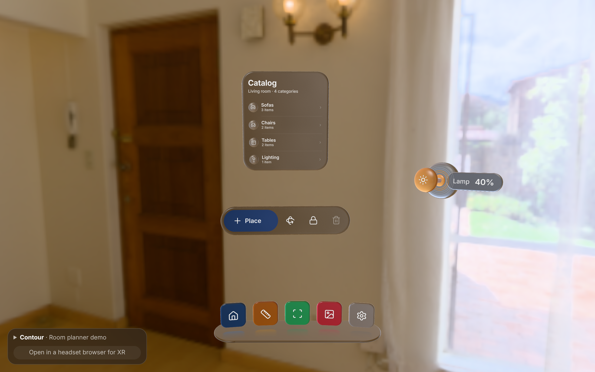
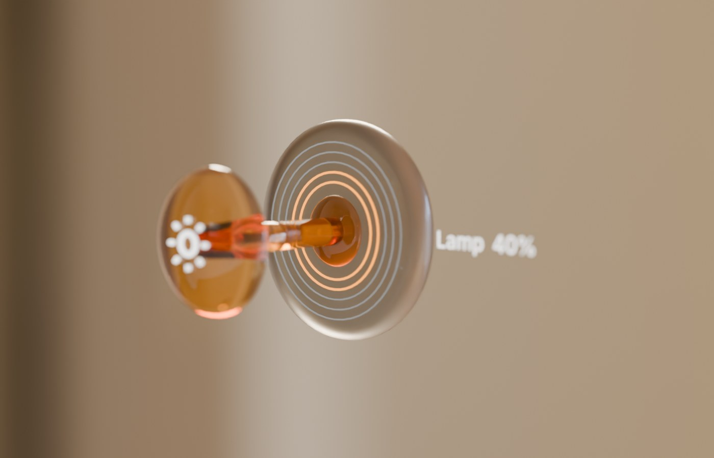
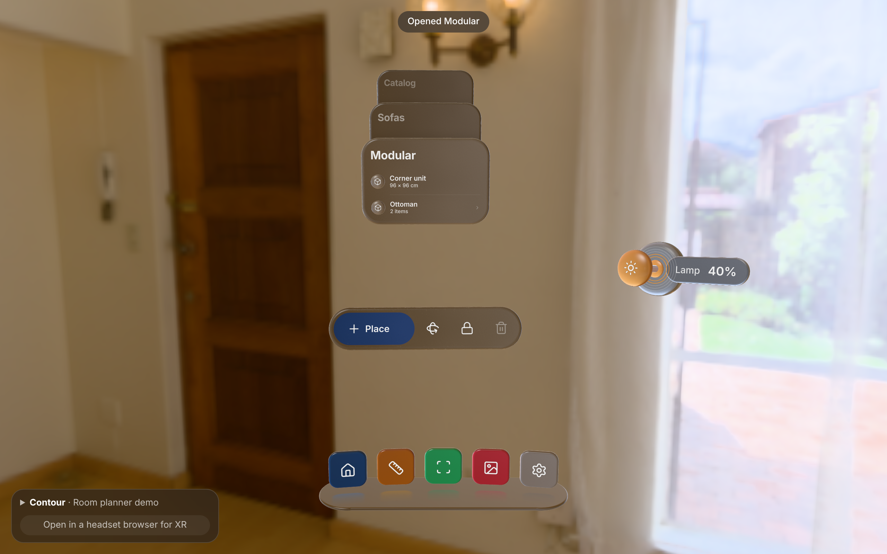
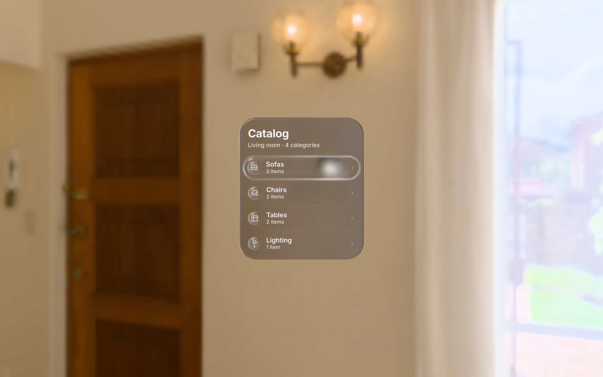
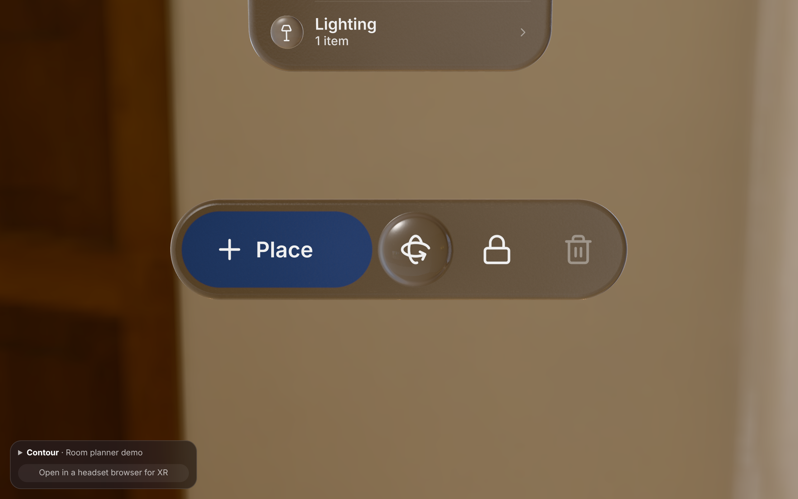
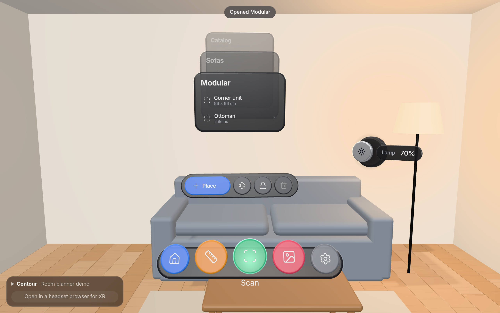

# Core components

Four three.js + WebXR components built on the tokens: **Button**, **Z-Slider**, **Packaging panel** and **Dock**. They don't hold any numbers of their own: every size, timing and ratio is read from [`tokens.json`](../tokens.json), so changing a token changes every component that uses it. The few values the tokens don't cover yet are collected in one file, listed [below](#values-the-tokens-dont-cover-yet).


*Captured 2026-10-20 from the demo, 2560 × 1600.* The Dock (curved glass shelf) and Z-Slider (amber glass stem) are the first live builds of their lookdev and are **in progress**: see [Dock](#dock) and [Z-Slider](#z-slider).

## Run the demo

```sh
npm install
npm run dev            # desktop browser: http://localhost:5173
npm run dev:headset    # https on your network, for a headset browser
```

The demo is a Room planner scene in a photographed living room: a Catalog window (packaging), a toolbar under it (buttons in all three densities), a Lamp knob (Z-Slider, which dims the room) and the Dock. On desktop the mouse acts as a far ray: hover, click to press, wheel or drag to push the Z-Slider, drag empty space (or ← →) to turn. In a headset, a hand closer than 35 cm to a component pokes it with the index fingertip, and further away it uses a ray with pinch. Edit `tokens.json` while the dev server runs and the page reloads with the new values.

Other commands: `npm test` (token check + interaction logic tests), `npm run shot` (renders the demo in headless Chromium and saves screenshots of each state to `shots/`), `npm run bench` (renders the Catalog window alone at a fixed framing in every state, to `shots/bench/`, for scored rounds against the visionOS bar), `npm run build` (static site in `site/`).

## How it looks

Behaviour comes from tokens; appearance lives in [`src/core/look.js`](../src/core/look.js). The bar is a shipping visionOS app. The Catalog window has been rebuilt to [the Catalog spec](catalog-spec.md); the toolbar, Z-Slider and Dock now use the same glass (2026-10-20).

- **Glass windows.** A window is a thick glass slab with a fully rounded rim. It shows the room behind it frosted and darkened, refracts it at the rim, reflects the room in front (strongest at the rim), and has a fine frost grain. It reads the room from the backdrop's light map along the view ray, so it works per eye in a headset with no extra render pass.
- **Adaptive scrim.** Over a bright part of the room the glass darkens just enough to keep white text legible, up to `surface.scrim.max`.
- **Contact shadows.** Layers that float in front of a window (a child level, a lifted row) cast soft shadows on it, softer the further away they are.
- **Thick controls.** Buttons and knobs are rounded solids extruded to their token thickness. Pressing compresses the solid and the face content moves with it. Thickness says "pressable", so windows don't have it.
- **List rows** are invisible at rest. On hover a light glass lens lifts out of the window, carrying the row with it; on press it moves back and shrinks slightly. Icons sit in glass beads.
- **Type ramp.** Inter as signed-distance-field text, on Apple's visionOS ramp converted at 1 pt ≈ 0.73 dmm (`DEFAULTS.type`). Secondary text is white at 72 %, not grey, so it stays legible over glass (vibrancy).
- **Backdrop.** On desktop and in VR the scene is a photographed interior (Poly Haven "lebombo", CC0), also used as the light. In mixed reality your real room replaces it.

Appearance options on `Button`: `shape` (`rounded`, `capsule`, `circle`), `variant` (`secondary`, `primary`, `plain`, `glass`, `tinted`, `window`), `icon`, `label`, `sublabel`, `accessory: 'chevron'`, `layout: 'row'`. `makePlatter()` draws a non-interactive toolbar background.

**Glass in mixed reality.** WebXR never gives the page the camera image of your room, so in mixed reality the glass cannot blur it. There the sheet falls back to a tinted surface at `surface.opacity.base`, which keeps text readable over any room. On desktop, in VR and in the arena, it is real frosted glass.

## Using a component

```js
import tokenJson from './tokens.json';
import { createTokens, Button, InputSystem } from './src/index.js';

const T = createTokens(tokenJson);            // tokens in metres, seconds, radians
const ok = new Button(T, { label: 'OK', density: 'firm' });
ok.addEventListener('select', () => console.log('pressed'));
scene.add(ok);

const input = new InputSystem({ T, renderer, camera, scene });
renderer.setAnimationLoop(t => {
  input.update();      // turns mouse / hands / controllers into probes
  ok.update(dt);       // each component reads its probes
  renderer.render(scene, camera);
});
```

`createTokens()` converts units once (mm → m, dmm → m at 1 m, deg → rad, ms → s), so components never do unit maths. `T.dmm(name, distance)` gives a dmm size at a placement distance. This is the same shape as the token pipeline's generated `dist/tokens.js`, so the components can switch to it by changing one import.

## Button

A thick object that compresses toward its back face when poked.

| Behaviour | Tokens |
|---|---|
| Thickness | `material.t.thin / regular / thick` |
| Press depth = ratio × t; recover time | `material.density.soft / firm / rigid .press, .recover` |
| Press starts on contact; release after the finger retreats 3 mm from the deepest point | `proximity.poke.press`, `proximity.poke.release` |
| Hover on at 100 dmm, off at 140 dmm | `proximity.hover.enter`, `.exit` |
| Hover glow fades in, 1.5 dmm wide | `motion.hover.in.*`, `feedback.glow.edge` |
| Face size 60 dmm | `size.button.default` |
| Opaque surface with a high-contrast outline | `surface.opacity.base`, `surface.outline.mr` |

Disabled buttons are always `rigid`: they barely give, which reads as "not now". Events: `press`, `release`, `select`, `cancel` (finger slid off).

## Z-Slider

A knob you push away from you (value up) and pull back (value down), along Z instead of X.

| Behaviour | Tokens |
|---|---|
| Travel from fully pulled to fully pushed | `zslider.travel` |
| A tick every 1/10 of the range, as sound | `feedback.detent.interval`, `.audio.gain`, `.audio.length` |
| Contact shadow grows and darkens with push | `feedback.shadow.press.*` |
| Hover, glow, surface | as Button |


*Rendered 2026-10-20 in Blender.* **In progress:** Jihoon picked this direction (A, stem) on 2026-10-20. The live knob (see the overview) is built to it: an amber glass bead on an amber stem from a flared foot, five etched rings that light amber up to the value, and the value label on lens glass beside the plate. Its glass still reads more opaque than the render.

How each input moves it: a fingertip can only **push** the face (like a real knob). **Pinching** near the knob grabs it so it can be pulled back. A **ray** (mouse, controller) drags it: moving the pointer further away pushes. The value is shown beside the knob, not on it, so the hand doesn't cover it. Five rings on the plate show the value at a glance (each is two detents); the 10 detents are felt as ticks. Events: `change`, `detent`.

## Packaging panel

A list whose rows open into a child panel that grows out of the row, instead of sliding in from the side.


*Captured 2026-10-20 from the demo, 2560 × 1600.*

| Behaviour | Tokens |
|---|---|
| What the parent does: compress, replace or protrude | `packaging.parent.mode` (switchable with `setMode()`) |
| Compress: back 50 mm, up 35 mm, 8 % smaller per level | `packaging.parent.recede.z / y / scale` |
| Parents darken 0.6 → −0.14 per level, never below 0.3 (they don't turn see-through) | `packaging.parent.recede.opacity.*` |
| Up to 3 levels deep; deeper rows show as disabled | `packaging.depth.max` |
| Open and close: a critically damped spring, response = the dropdown duration | `motion.expand.dropdown.duration` |

Rows use the bubble language (see Decisions): on hover the window glass swells into a pillow under the row; on press a dent gives way where the press lands and lights from inside.


*Captured 2026-10-20 from the demo, 2560 × 1600.*


*Captured 2026-10-20 from the demo, 2560 × 1600.* Receded parents are pressable: pressing one goes back to it. That is the wayfinding idea from the concepts doc: their headers are the breadcrumb. Try "replace" in the demo and the breadcrumb disappears. The child grows out of the row that opened it and closes back into it, and a fast open-and-back never jumps, because every channel is a spring that starts from where it is. Glass never shows another glass sheet through it, so a child always covers its parent cleanly. The panel itself is a `rigid`, `thin` glass sheet; rows are `thin`, `firm` buttons. Events: `open`, `back`, `select`.

## Toolbar

An ornament of actions under a window: one glass bar whose buttons are places where its own glass swells into a bubble on hover and dents on press. The primary action is a patch of accent-tinted glass (`DEFAULTS.color.accentGlass`), so the room shows through it blue; in tinted glass the press light takes the glass's colour. Events: `select` (with the tool and its index).


*Captured 2026-10-20 from the demo, 2560 × 1600.*

## Dock

The app launcher, body-locked 25° below your view.


*Rendered 2026-10-20 in Blender (`lookdev/dock_slider.py --part dock --option shelf --state hover`), 2560 × 1600.* **In progress:** this is the lookdev target. The live Dock (built 2026-10-20, see the overview) follows it: tinted glass tiles floating over a smoky glass shelf on an arc centred on you, reflections as soft colour in the glass. The hand is not modelled in the render; the shown state is the magnification a nearby hand triggers.

| Behaviour | Tokens |
|---|---|
| Body-lock (only mode implemented) | `anchor.mode` |
| 25° below the centre of view | `anchor.eccentricity.vertical` |
| Waits 350 ms after a turn, then follows without wobble | `anchor.follow.delay`, `.damping`, `.frequency` |
| Icons grow up to 1.6× within 250 dmm of the hand, cosine falloff | `dock.magnify.*` |
| Icon size and gaps | `size.button.default`, `size.gap.min` |

WebXR doesn't track the torso, so the dock treats a sustained head turn (more than 20°, held for the delay) as a body turn. A quick glance away never moves it. Events: `select`.

## Lookdev frames kept for comparison

Path-traced Blender references and 6K stills, in [`images/lookdev/`](images/lookdev/):

| File | What it shows | Captured |
|---|---|---|
| `bubble-blender-states.jpg` | The bubble reference in Blender: rest, hover, press | 2026-10-19 |
| `catalog-press-6k.jpg` | Live Catalog at 6K (6144 × 3456), row pressed | 2026-10-20 |
| `row-hover-vs-press-6k.jpg` | 100 % crop of a 6K row: hover next to press | 2026-10-20 |
| `press-0.6m-vs-2m-6k.jpg` | The same press at 0.6 m and 2 m (emboss scales with distance) | 2026-10-20 |
| `dock-options.jpg` | Dock directions A bead, B inlay, C layered (before the shelf) | 2026-10-20 |
| `slider-options.jpg` | Z-Slider directions A stem, B column, C membrane | 2026-10-20 |
| `slider-stem.jpg` | Z-Slider A refined (in progress) | 2026-10-20 |

## Input

`InputSystem` turns every input into the same kind of "probe" in each component's own space, so components don't care where input came from:

| Input | Becomes |
|---|---|
| Hand or controller within 350 mm (±50 mm hysteresis) of a component | **poke**: the index fingertip (or controller grip) position, plus pinch state |
| Hand or controller further away | **ray** from the hand or controller, pinch/trigger = press |
| Desktop mouse | **ray** from the camera, click = press, wheel = push/pull |

## Values the tokens don't cover yet

These live in [`src/core/defaults.js`](../src/core/defaults.js), one file, so they're easy to find and promote. Each is a candidate token.

| Value | Now | Why it's needed | Proposed token |
|---|---|---|---|
| Placement distance for dmm | 0.6 m | dmm needs a distance to become metres | `placement.distance.near` |
| Corner radius | window 34, row 15, control 12 dmm | every surface has corners | `shape.radius.*` |
| Hover fade out | same as in | only `motion.hover.in` exists | `motion.hover.out.*` |
| Panel layout | width 240, row 48, padding 18 dmm, and the gaps in [the spec](catalog-spec.md) | the packaging panel's layout | `size.panel.*`, `size.row.*` |
| Type ramp | title 21 / headline 12.4 / body 12.4 / subheadline 11 / footnote 9.5 dmm (Apple's kit × 0.73) | text needs sizes, weights and tracking | `type.*` |
| Text emphasis | white at 100 / 90 / 50 % | contrast on glass | `color.text.*` |
| Dock follow threshold | 20° | without it, every small head move restarts the delay | `anchor.follow.threshold` |
| Dock distance | 0.55 m | body-lock needs a distance | `anchor.distance` |
| Glass (blur, refraction, Fresnel, grain, veil), bubble (`look.emboss`: height, dent, glow), contact shadows | see `look` | appearance of windows and rows | `look.*`, `feedback.press.*` |
| Colours | dark graphite surfaces, blue accent | there are no colour tokens yet | `color.*` (MR contrast work) |

## Known limits

- **The adaptive scrim works only where the page can see the room** (desktop, VR, arena). In mixed reality it would need the camera image, which WebXR doesn't give by default; there the glass uses the fixed `surface.opacity.base`.
- **Glass blurs the backdrop, not other 3D objects.** An object between the window and the room (a placed sofa) won't show through the glass. Fine for windows over a room; a real blur pass would be needed for objects.
- **The backdrop photo is 1k**, so the room looks softly out of focus. Higher-resolution interiors weren't reachable from the build environment.
- **Not yet tried on a headset.** Desktop rendering and the interaction logic are tested; hand poke and pinch follow the WebXR Hand Input spec but need a real device check, especially the follow and hover values tagged G.
- **Audio** starts after the first click or tap, because browsers block sound until the user interacts.

## Decisions

### Colour lives in the glass (2026-10-20)
- **Decision:** Accent colour is tinted glass: the glass's own transmission is coloured, so the room shows through it in that colour (the toolbar's primary button, Dock icons). No opaque colour fills on glass.
- **Why:** One material everywhere, and tint darkens what's behind white text, so legibility holds (Place: 11:1).
- **Alternatives:** A coloured light inside clear glass (reads as a state, not an identity); an opaque fill (clearest, but breaks the material).
- **Trade-offs:** Tinted glass changes with the room behind it; over a saturated room the hue shifts. Unsaturated colours (Settings' grey) use the plain window glass.

### Known gaps handed to the arena (2026-10-20)
- **Dock:** built live as the curved shelf (Jihoon's Snow Leopard direction). Reflections are colour decals, not a real mirror; tiles are a little thick.
- **Z-Slider:** built live as direction A (stem). The amber glass reads more opaque and pastel than the lookdev; the value label needs a scrim beyond `surface.scrim.max` over bright windows (proposed `surface.scrim.label`).
- **Backdrop:** the room photo is 1K; renders at 6K show it soft. A 4K+ file is needed (Poly Haven is blocked from the cloud).

### Bubble: the hover and press language (locked 2026-10-20)
- **Decision:** A hovered row doesn't get a separate lens or a colour fill. The window's own glass swells into a soft pillow under it (6 mm at 0.6 m, domed like the icon beads, glossy and clearer on the crown). Pressing makes a dent where the press lands (bell-shaped, 20 mm wide at half depth, 4.5 mm deep), shaded as a hollow with an inner shadow on the wall facing the light. Light gathers in an 8 mm core at the bottom of the dent and travels to the bubble's edge, brightest nearest the finger. On release the dent springs back past flat once; the bubble deflates without a wobble. Values: `DEFAULTS.look.emboss`.
- **Why:** Jihoon's reference is a fluid-filled tactile display: the surface itself becomes the button. Path-traced lookdev (`lookdev/catalog.py`) chose the pillow over a flat plateau, and a blind critique chose the shading and glow fixes. The glow makes the press visible by light as well as by shape (WCAG 1.4.11, non-text contrast); the bloom under text stays under the legibility cap.
- **Distance and input:** sizes are mm as seen at 0.6 m and grow with the window's distance like dmm, so a far window reads the same. A fingertip drags the dent along; a ray or gaze-and-pinch pins it where the pinch began (eye tracking wobbles about 1°). Far away the dent reads by shading and glow, since stereo depth fades with the square of distance.
- **Alternatives:** A light glass lens lifted over the row (`hoverStyle: 'lens'`, still available). It reads fast, but as a separate slab, not the window's own material. A squash press (whole pillow flattens): calmer, but hard to tell from hover.
- **Trade-offs:** The bubble is a shader effect on a finely split window mesh, so windows cost more vertices. Pressing directly on text briefly lowers that text's contrast under the glow core. With reduced motion, the bubble and dent move without settle or rebound.


### Components take tokens as an argument instead of importing them
- **Decision:** `new Button(T, …)` receives a token object; no component imports `tokens.json` itself.
- **Why:** It keeps one source of truth while letting the source change. Today `T` comes from raw `tokens.json`; tomorrow from the pipeline's generated file, a Figma export, or a test fixture with different values. In Figma terms: components are linked to a library, and you can swap which library.
- **Alternatives:** Each component imports `tokens.json` directly. Shorter to use, but every component would need editing when the pipeline lands, and tests couldn't try other values.
- **Trade-offs:** One extra argument on every constructor.

### Interaction logic is separate from rendering
- **Decision:** Press, hysteresis, follow, magnify and packaging poses are small pure functions or classes (`PressModel`, `Hysteresis`, `LazyFollow`, `packagingPose`, `magnifyScale`) that the three.js components call.
- **Why:** These are the parts the tokens describe, and the parts that need to match across the website, Unity and any future renderer. Keeping them pure means they run in Node tests without a browser or headset, and can be ported one function at a time.
- **Alternatives:** Logic inside each component's update loop. Fewer files, but untestable without rendering.
- **Trade-offs:** A few more files to read when following one behaviour end to end.

### Press: down follows the finger, up springs back at the material's pace
- **Decision:** Going down, the surface tracks the finger exactly (`motion.press.down = follow-input`). Coming back up, it eases back so a full recovery takes exactly `density.recover`, even while the finger is still touching.
- **Why:** Recovery only shows if the surface can lag behind the finger. If it followed the finger both ways, soft and rigid would look the same on the way up, and the recover tokens would do nothing.
- **Alternatives:** Follow the finger both ways and only animate after release. Simpler, but the release hysteresis means the finger is already 3 mm back by then, so there is almost nothing left to animate.
- **Trade-offs:** A soft surface briefly separates from a fast-retreating finger. That is the intended feel, but it should be checked on a headset.

### Ray input presses fully and releases cleanly
- **Decision:** A ray (mouse, controller, far pinch) has no depth, so a ray press goes straight to full press depth, and letting go releases immediately.
- **Why:** Release hysteresis is for a finger hovering at the surface. A ray press is already a clean on/off signal.
- **Alternatives:** Simulate a finger moving in. Would make every click feel slow.
- **Trade-offs:** On desktop you see the press depth but not the "follow" feel. That only exists with hands.

### three.js + WebXR, with Vite for the dev server
- **Decision:** Components are plain JavaScript modules on three.js. The demo uses Vite.
- **Why:** three.js is a widely used WebGL/WebXR library that runs in headset browsers and on desktop, so the same page works for quick desktop checks and real headset tests. Vite gives a dev server that reloads when `tokens.json` changes and an https mode for headsets, which WebXR requires.
- **Alternatives:** React Three Fiber (nicer for app code, but adds React to a component library that doesn't need it); Unity (best headset tooling, but no browser preview and a separate codebase from the website).
- **Trade-offs:** ⚠️ Components are tied to three.js objects. The pure logic ports anywhere, but a Unity version would re-implement the rendering parts.
